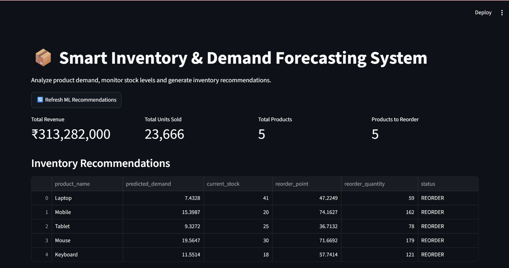
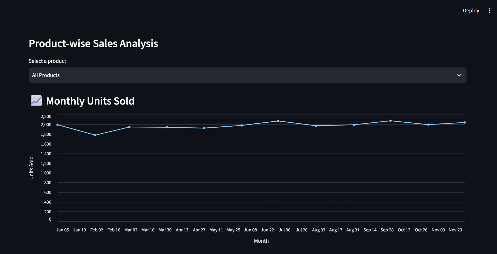
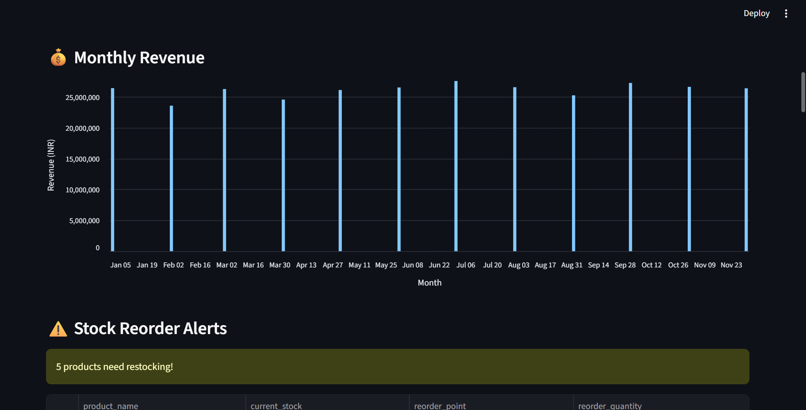
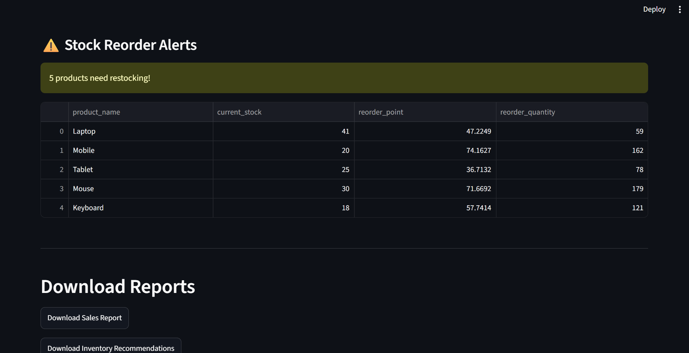
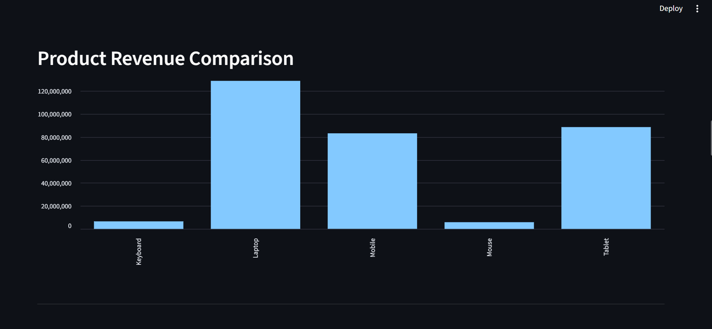
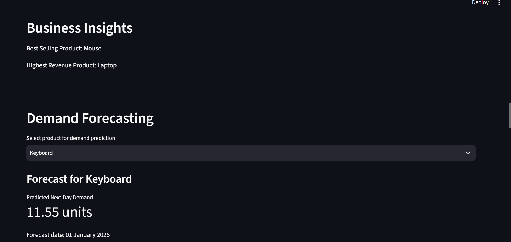
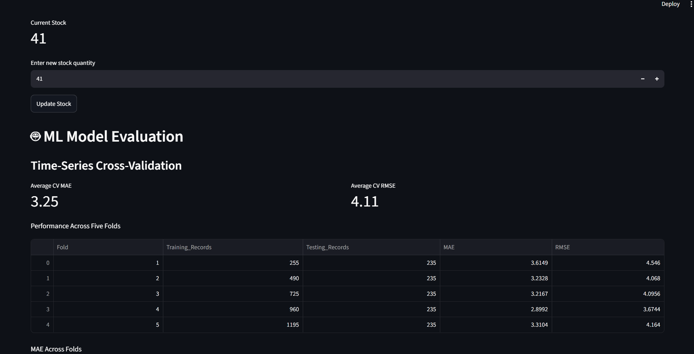
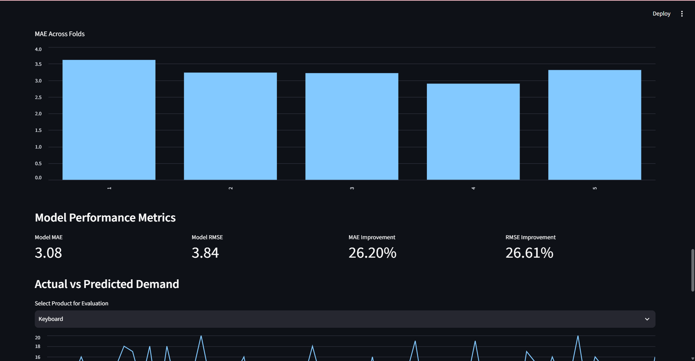
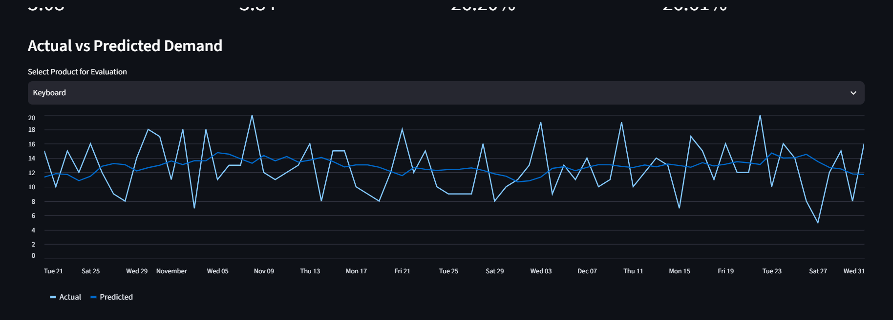
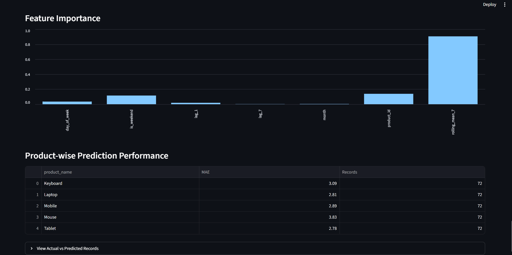

# Smart Inventory Forecasting System

An end-to-end inventory analytics and demand forecasting project built using Python, Machine Learning, MySQL, and Streamlit.

## Project Overview

The Smart Inventory Forecasting System analyzes historical sales data, predicts product demand, monitors inventory levels, and generates data-driven reorder recommendations.

The project demonstrates an applied machine learning workflow, from data preparation and feature engineering to model evaluation, inventory decision logic, and an interactive dashboard.

## Technologies Used

- **Programming:** Python
- **Data Analysis:** Pandas, NumPy
- **Machine Learning:** Scikit-learn
- **Database:** MySQL
- **Dashboard:** Streamlit, Altair
- **Model Persistence:** Joblib
- **Testing:** Python unittest
- **Development:** VS Code, Git

## Key Features

- Historical sales analysis and visualization
- Data cleaning and feature engineering
- Product-level demand forecasting
- Comparison of multiple regression models
- Time-series cross-validation
- Inventory monitoring using MySQL
- Safety stock and reorder point calculations
- Automated reorder quantity recommendations
- Interactive Streamlit dashboard
- Model performance visualization
- Unit testing of inventory business logic

## Machine Learning Approach

The system uses historical sales patterns and engineered features, including:

- Product ID
- Month
- Day of the week
- Weekend indicator
- Previous-day sales (lag 1)
- Previous-week sales (lag 7)
- Seven-day rolling mean

Five regression models were compared using time-series cross-validation.

### Model Comparison

| Model | CV MAE | CV RMSE |
|---|---:|---:|
| Linear Regression | 3.05 | 3.90 |
| Gradient Boosting | 3.17 | 4.07 |
| Random Forest | 3.25 | 4.11 |
| Extra Trees | 3.29 | 4.17 |
| Decision Tree | 4.41 | 5.65 |

Linear Regression achieved the lowest average cross-validation error and was selected as the final model.

### Final Model Performance

- **Mean Absolute Error (MAE):** 3.08
- **Root Mean Squared Error (RMSE):** 3.84
- **MAE improvement over naive baseline:** 26.2%
- **RMSE improvement over naive baseline:** 26.61%

These results were obtained on the project's historical test dataset and do not guarantee future forecasting accuracy.

## Inventory Recommendation Logic

The system calculates reorder recommendations using predicted demand, supplier lead time, safety stock, and current inventory.

**Reorder Point:**

`Reorder Point = Predicted Daily Demand × Lead Time + Safety Stock`

**Reorder Quantity:**

When current stock is at or below the reorder point, the system calculates the quantity needed to reach a target stock level that includes additional coverage days.

The system displays inventory statuses such as `REORDER` and `STOCK AVAILABLE`.

## Project Structure

```text
smart_inventory_forecasting/
├── app/
│   └── app.py
├── data/
│   ├── raw/
│   └── processed/
├── database/
├── models/
│   └── inventory_demand_model.pkl
├── src/
│   ├── inventory_logic.py
│   ├── inventory_recommendations.py
│   ├── prepare_data.py
│   └── train_model.py
├── tests/
│   ├── test_inventory.py
│   └── test_inventory_logic.py
├── main.py
├── requirements.txt
├── .gitignore
└── README.md
```

## Installation

### 1. Clone the repository

```bash
git clone <repository-url>
cd smart_inventory_forecasting
```

Replace `<repository-url>` with the actual GitHub repository URL.

### 2. Create a virtual environment

```bash
python -m venv venv
```

Activate it on Windows PowerShell:

```powershell
.\venv\Scripts\Activate.ps1
```

### 3. Install dependencies

```bash
python -m pip install -r requirements.txt
```

### 4. Configure MySQL

Make sure MySQL Server is installed and running.

**Create the database and tables**

From the project root, run:

```powershell
mysql -u root -p < database/schema.sql
```

Enter your MySQL password when prompted.

Alternatively, open MySQL Command Line Client and run:

```sql
SOURCE C:/path/to/smart_inventory_forecasting/database/schema.sql;
```

The SQL script creates the `smart_inventory_db` database, the `sales` and `inventory` tables, and five sample inventory records.

**Configure environment variables**

Create a `.env` file in the project root:

```dotenv
DB_HOST=localhost
DB_USER=root
DB_PASSWORD=your_mysql_password
DB_NAME=smart_inventory_db
```

Replace the example credentials with your own. Never commit the `.env` file.

**Import historical sales data**

From the project root, run:

```powershell
python database/import_sales.py
```

The import script loads the historical sales dataset from `data/raw/inventory_sales.csv`. It skips importing if the `sales` table already contains records.

**Generate inventory recommendations**

Run:

```powershell
python -m src.inventory_recommendations
```

This generates inventory reorder recommendations using the trained machine learning model and MySQL inventory records.

The database must be configured before using database-dependent dashboard features.

### 5. Run the dashboard

```bash
python -m streamlit run app/app.py
```

## Testing

Run the unit tests:

```bash
python -m unittest discover -s tests -p "test_*.py" -v
```

**Latest verified result:** 13 tests passed, 0 failures.

## Current Limitations

- Forecast accuracy depends on the available historical sales data.
- Reorder calculations rely on the inventory and lead-time values stored in MySQL.
- External demand drivers such as promotions and holidays are not fully modeled.
- Unit tests cover inventory logic but do not constitute complete end-to-end testing.

## Future Improvements

- Automated data ingestion
- Improved holiday and promotion features
- More advanced forecasting models
- Model monitoring and retraining
- Additional database integration tests
- Deployment and production monitoring

## Project Purpose

This project was developed to demonstrate practical skills in Python programming, SQL, machine learning, data analysis, inventory optimization, and dashboard development.


---

## 📸 Dashboard Screenshots

### 1. Dashboard Overview

Interactive dashboard displaying business KPIs, predicted demand,
current stock levels, and inventory reorder recommendations.



### 2. Monthly Sales Analysis

Interactive product-wise monthly sales trend analysis.



### 3. Monthly Revenue Analysis

Monthly revenue visualization for business decision-making.



### 4. Automated Stock Reorder Alerts

Low-stock detection and automated reorder quantity recommendations.



### 5. Product Revenue Comparison

Product-wise revenue comparison to identify high-performing products.



### 6. Machine Learning Demand Forecasting

Product-specific next-day demand predictions based on historical sales data.



### 7. Time-Series Cross-Validation

Model evaluation using five chronological validation folds.



### 8. Model Performance Evaluation

The selected Linear Regression model achieved the following
results on the holdout test dataset:

| Evaluation Metric | Result |
|---|---:|
| Mean Absolute Error (MAE) | 3.08 |
| Root Mean Squared Error (RMSE) | 3.84 |
| MAE Improvement over Baseline | 26.20% |
| RMSE Improvement over Baseline | 26.61% |



### 9. Actual vs Predicted Demand

Visual comparison of actual product demand and predicted demand.



### 10. Feature Analysis and Product-wise Performance

Model feature analysis and individual product prediction errors.



---
